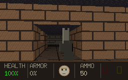
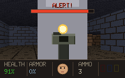
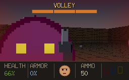

# pandemonium

> *pandemonium* — all the demons, in one place.

[](https://github.com/danielriddell21/pandemonium/actions/workflows/ci.yaml)
[](https://codecov.io/gh/danielriddell21/pandemonium)
[](https://sonarcloud.io/summary/new_code?id=danielriddell21_pandemonium2)
[](https://go.dev)
[](LICENSE)

A procedurally-generated, Wolfenstein-3D-style raycaster FPS written in Go with [Ebiten](https://ebitengine.org/) v2, in the visual spirit of the original DOOM.

Every run generates a fresh maze of rooms and corridors — staircases, lifts, raised platforms, the odd open-sky courtyard. Walk it with `WASD`, look with the mouse, hold the trigger to fire, and reach the exit to collapse the level and spawn a new one. Levels are deterministic from their seed.

What you carry out of a level — armour, ammo, the backpack — you carry into the next, and each floor down holds more demons than the last.

- **The alarm.** Gunfire fills an alert meter, and so does lingering past par. When it tops out the level's demons come hunting and a wave of reinforcements arrives out of sight; every alarm brings a bigger one. Reinforcements drop ammo and health, so a loud run can pay for itself — if you survive it. Fists are silent, and one wall panel per level silences the alarm once.
- **The overlord.** Every fifth floor is an open arena sealed by a boss. It telegraphs each attack — a spread of fireballs, a summoning, a charge down a fixed lane — and grows faster as it weakens. Break its line of fire behind a pillar, or bait the charge into one: a stunned overlord takes double damage. It drops a megasphere and a backpack, and the exit opens when it falls.

```sh
go run ./cmd/pandemonium --seed 42
```



| The alert meter | The overlord winding up |
| --- | --- |
|  |  |

## Install

### Homebrew (macOS)
```sh
brew install --cask danielriddell21/tap/pandemonium
```

### From source
On Linux/Windows, build from source:

```sh
go build ./cmd/pandemonium
```

<details>
<summary>Linux: OpenGL/X11 libraries</summary>

The window needs OpenGL/X11. On Debian/Ubuntu:

```sh
sudo apt install libgl1-mesa-dev libxrandr-dev libxcursor-dev libxinerama-dev libxi-dev
```
</details>

## Documentation

Full documentation lives in the [pandemonium wiki](https://github.com/danielriddell21/pandemonium/wiki) — features, controls, CLI flags, settings, and how the raycaster, world generation and audio work.
